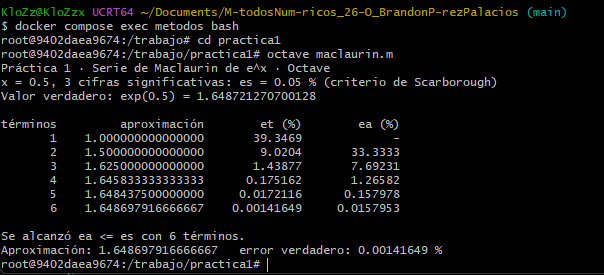
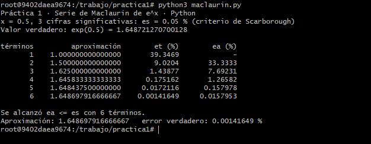
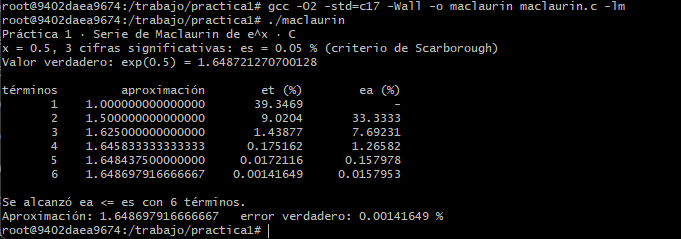

# Práctica 1 · La serie de Maclaurin y el criterio de paro

**UEA 1151039 · Métodos Numéricos en Ingeniería · Trimestre 26-O · UAM Azcapotzalco**
**Profesor:** M. en C. Gabriel Hurtado Avilés

| | |
|---|---|
| **Equipo** |  |
| **Integrantes (nombre, matrícula y licenciatura)** | Brandon Pérez Palacios 2252000616 Licenciatura en Ingeniería Electrónica |
| **Repositorio de la Tarea 1 de** | Brandon Pérez Palacios |
| **Fecha** | 12 de octubre del 2026 |

## 1. Octave y Python




**¿Coinciden con la lámina 25 de la unidad I?**
Sí coinciden.

## 2. Las dos líneas que completamos en `maclaurin.c`

```c
/* COMPLETAR 1 */
/* COMPLETAR 2 */
```



## 3. Más cifras significativas

| Cifras | εs (%) | Términos | Aproximación | Error verdadero (%) |
|:---|:---|:---|:---|:---|
| **3** | 0.05 % | 6 | 1.648697916666667 | 0.00141649 % |
| **6** | 5e-05 % | 9 | 1.648721265035962 | 3.43549e-07 % |
| **17** | 5e-16 % | 16 | 1.648721270700128 | 2.69354e-14 % |

1. ¿Cuántos términos hacen falta en cada caso?
Hacen falta 6 términos para 3 cifras, 9 términos para 6 cifras y 16 términos para 17 cifras.
2. En cada fila de la tabla, ¿εa es mayor o menor que εt? ¿Por qué conviene detenerse con εa?
En las iteraciones, el error relativo aproximado (εa) es siempre **mayor** (conservador) que el error verdadero (εt). Conviene detenerse utilizando εa porque en un problema real de ingeniería **el valor verdadero es desconocido**, por lo que resulta imposible calcular εt; por el contrario, εa nos permite saber cuándo detenernos evaluando únicamente qué tanto está cambiando el resultado usando las propias aproximaciones iterativas que vamos calculando.
3. Con 17 cifras el programa termina. ¿Cuántas cifras del resultado son correctas en realidad?
   Relaciónenlo con 0.1 + 0.2 de la Tarea 1.
Aunque el criterio de paro alcance el objetivo para 17 cifras, en realidad solo alrededor de **15 o 16 cifras** son matemáticamente correctas. Esto se relaciona directamente con el problema de $0.1 + 0.2$ de la Tarea 1: la precisión de la máquina. La computadora utiliza un estándar de precisión doble de 64 bits para el punto flotante, lo que significa que su memoria para los decimales no es infinita. A partir de la cifra número 16, el truncamiento para guardar los datos en binario genera ruido numérico y pequeños errores de redondeo, haciendo imposible obtener 17 cifras puramente exactas.

## Uso de inteligencia artificial

Gemini AI / Lo utilice para diagnosticar y depurar un error lógico de sobreescritura de variables del archivo en C (maclaurin.c), también lo ocupe para resolver dudas sobre comandos específicos del entorno Docker/Git, y como guía para estructurar el análisis sobre el truncamiento de punto flotante en el Ejercicio 4.

## Referencias

- Chapra, S. C., & Canale, R. P. (2015). Métodos Numéricos para Ingenieros (7a ed.). McGraw-Hill. (Capítulo 3 y 4).
- Burden, R. L., & Faires, J. D. (2011). Análisis Numérico (9a ed.). Cengage Learning. (Capítulo 1).