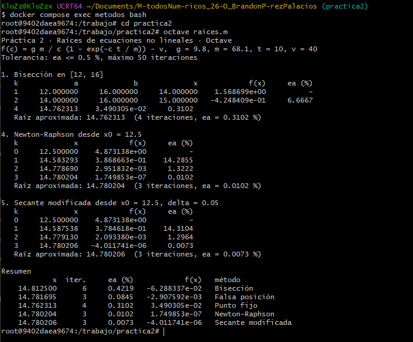
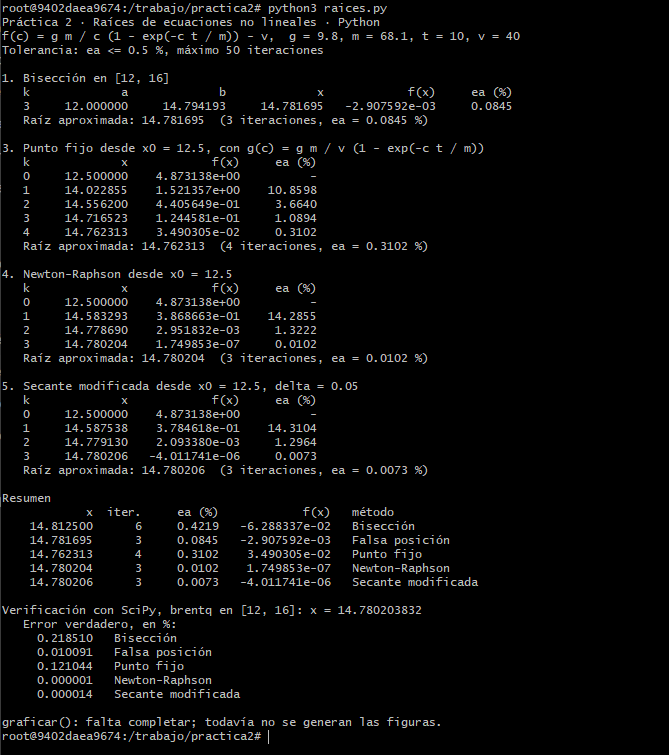
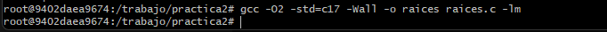
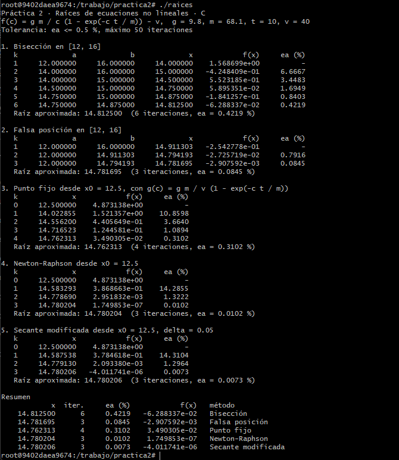
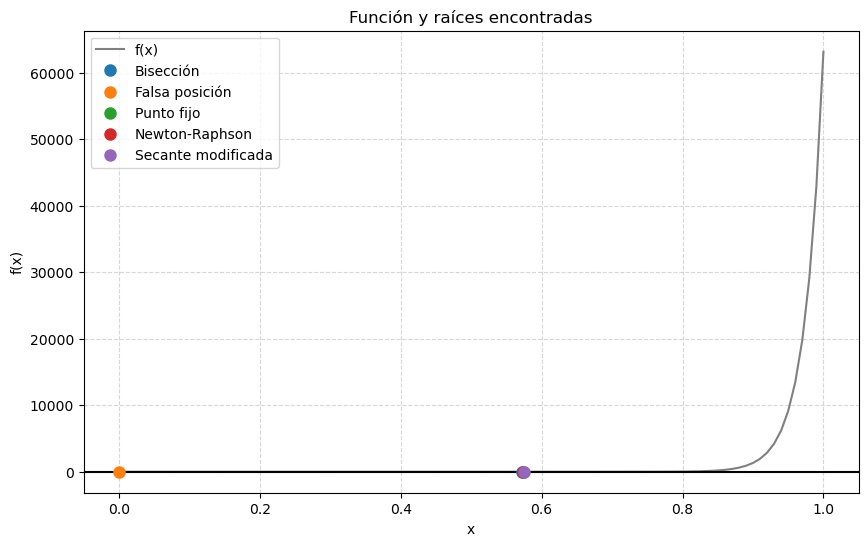
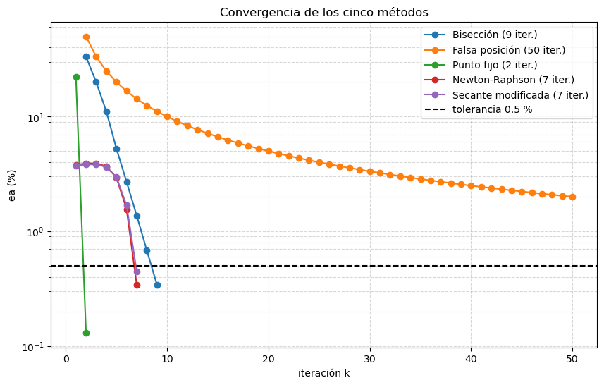
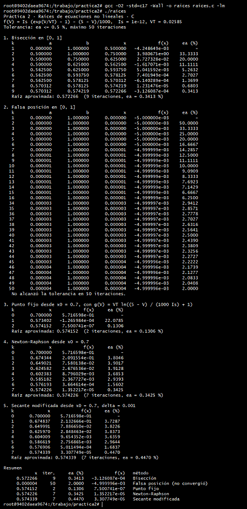
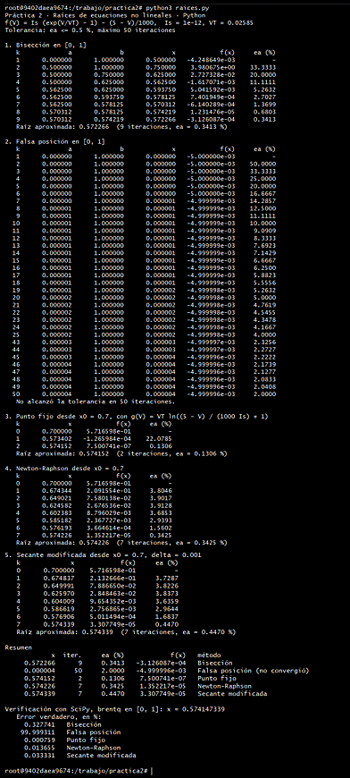
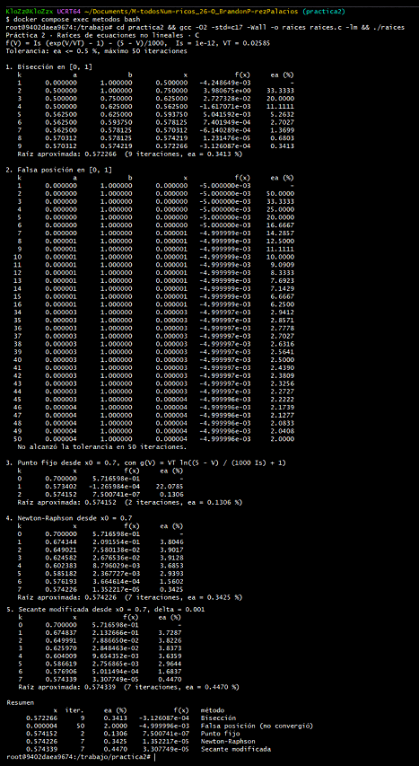

# Práctica 2 · Raíces de ecuaciones no lineales

**UEA 1151039 · Métodos Numéricos en Ingeniería · Trimestre 26-O · UAM Azcapotzalco**
**Profesor:** M. en C. Gabriel Hurtado Avilés

| | |
|---|---|
| **Equipo** | |
| **Integrantes (nombre, matrícula y licenciatura)** | Brandon Pérez Palacios 2252000616 Licenciatura en Ingeniería Electrónica |
| **Ecuación asignada** | 13 Diodo con resistencia |
| **Fecha** | 16 de octubre del 2026 |

---

## 1. Octave y Python con el paracaidista

Capturas de `octave raices.m` y de `python3 raices.py` sin cambiar nada. Sus tablas
coinciden con las de las láminas de la unidad II.




## 2. Las cinco líneas que completamos en `raices.c`

```c
return fabs((nuevo - anterior) / nuevo) * 100.0;
x = (a * f(b) - b * f(a)) / (f(b) - f(a));
x_nuevo = g(x);
 x_nuevo = x - f(x) / fp(x);
x_nuevo = x - f(x) / ((f(x + delta) - f(x)) / delta);
```




¿Coinciden las tablas de C con las de Octave y Python? Sí / No, y en qué.
Sí. Las tablas de C coinciden cifra por cifra con las de Octave y Python en todas sus columnas: el número de iteración (k), los valores de los intervalos (a y b), las aproximaciones calculadas (x), la evaluación de la función (f(x)) y el error relativo aproximado (εa).

## 3. Las gráficas de Python




## 4. Nuestra ecuación

| | |
|---|---|
| f(x) | $f(V) = I_s (\exp(V/V_T) - 1) - (5 - V)/1000$ |
| f'(x) | $f'(V) = (I_s / V_T) \exp(V/V_T) + 1/1000$ |
| g(x) | $g(V) = V_T \ln(((5 - V) / (1000 I_s)) + 1)$ |
| Intervalo [a, b] | $[0, 1]$ |
| x₀ y δ | $x_0 = 0.7, \delta = 0.001$ |
| Tolerancia | εa ≤ 0.5 % |

(Nota: $I_s = 1\times 10^{-12}$ y $V_T = 0.02585$). 




### Tablas (salida de C)

**Bisección**

| k | a | b | x | f(x) | εa (%) |
|---|---|---|---|---|---|
| 1 | 0.000000 | 1.000000 | 0.500000 | -4.248649e-03 | - |
| 2 | 0.500000 | 1.000000 | 0.750000 | 3.980675e+00 | 33.3333 |
| 3 | 0.500000 | 0.750000 | 0.625000 | 2.727328e-02 | 20.0000 |
| 4 | 0.500000 | 0.625000 | 0.562500 | -1.617071e-03 | 11.1111 |
| 5 | 0.562500 | 0.625000 | 0.593750 | 5.041592e-03 | 5.2632 |
| 6 | 0.562500 | 0.593750 | 0.578125 | 7.401949e-04 | 2.7027 |
| 7 | 0.562500 | 0.578125 | 0.570312 | -6.140289e-04 | 1.3699 |
| 8 | 0.570312 | 0.578125 | 0.574219 | 1.231476e-05 | 0.6803 |
| 9 | 0.570312 | 0.574219 | 0.572266 | -3.126087e-04 | 0.3413 |

**Falsa posición**

| k | a | b | x | f(x) | εa (%) |
|---|---|---|---|---|---|
| 1 | 0.000000 | 1.000000 | 0.000000 | -5.000000e-03 | - |
| 2 | 0.000000 | 1.000000 | 0.000000 | -5.000000e-03 | 50.0000 |
| 3 | 0.000000 | 1.000000 | 0.000000 | -5.000000e-03 | 33.3333 |
| 4 | 0.000000 | 1.000000 | 0.000000 | -5.000000e-03 | 25.0000 |
| 5 | 0.000000 | 1.000000 | 0.000000 | -5.000000e-03 | 20.0000 |
| 6 | 0.000000 | 1.000000 | 0.000000 | -5.000000e-03 | 16.6667 |
| 7 | 0.000000 | 1.000000 | 0.000001 | -4.999999e-03 | 14.2857 |
| 8 | 0.000001 | 1.000000 | 0.000001 | -4.999999e-03 | 12.5000 |
| 9 | 0.000001 | 1.000000 | 0.000001 | -4.999999e-03 | 11.1111 |
| 10 | 0.000001 | 1.000000 | 0.000001 | -4.999999e-03 | 10.0000 |
| 11 | 0.000001 | 1.000000 | 0.000001 | -4.999999e-03 |  9.0909|
| 12 | 0.000001 | 1.000000 | 0.000001 | -4.999999e-03 | 8.3333 |
| 13 | 0.000001 | 1.000000 | 0.000001 | -4.999999e-03 | 7.6923 |
| 14 | 0.000001 | 1.000000 | 0.000001 | -4.999999e-03 | 7.1429 |
| 15 | 0.000001 | 1.000000 | 0.000001 | -4.999999e-03 | 6.6667 |
| 16 | 0.000001 | 1.000000 | 0.000001 | -4.999999e-03 | 6.2500 |
| 34 | 0.000003 | 1.000000 | 0.000003 | -4.999997e-03 | 2.9412 |
| 35 | 0.000003 | 1.000000 | 0.000003 | -4.999997e-03 | 2.8571 |
| 36 | 0.000003 | 1.000000 | 0.000003 | -4.999997e-03 | 2.7778 |
| 37 | 0.000003 | 1.000000 | 0.000003 | -4.999997e-03 | 2.7027 |
| 38 | 0.000003 | 1.000000 | 0.000003 | -4.999997e-03 | 2.6316 |
| 39 | 0.000003 | 1.000000 | 0.000003 | -4.999997e-03 | 2.5641 |
| 40 | 0.000003 | 1.000000 | 0.000003 | -4.999997e-03 | 2.5000 |
| 41 | 0.000003 | 1.000000 | 0.000003 | -4.999997e-03 | 2.4390 |
| 42 | 0.000003 | 1.000000 | 0.000003 | -4.999997e-03 | 2.3809 |
| 43 | 0.000003 | 1.000000 | 0.000003 | -4.999997e-03 | 2.3256 |
| 44 | 0.000003 | 1.000000 | 0.000003 | -4.999997e-03 | 2.2727 |
| 45 | 0.000003 | 1.000000 | 0.000004 | -4.999996e-03 | 2.2222 |
| 46 | 0.000004 | 1.000000 | 0.000004 | -4.999996e-03 | 2.1739 |
| 47 | 0.000004 | 1.000000 | 0.000004 | -4.999996e-03 | 2.1277 |
| 48 | 0.000004 | 1.000000 | 0.000004 | -4.999996e-03 | 2.0833 |
| 49 | 0.000004 | 1.000000 | 0.000004 | -4.999996e-03 | 2.0408 |
| 50 | 0.000004 | 1.000000 | 0.000004 | -4.999996e-03 | 2.0000 |

**Punto fijo**

| k | x | f(x) | εa (%) |
|---|---|---|---|
| 0 | 0.700000 | 5.716598e-01 | - |
| 1 | 0.573402 | -1.265984e-04 | 22.0785 |
| 2 | 0.574152 | 7.500741e-07 | 0.1306 |

**Newton-Raphson**

| k | x | f(x) | εa (%) |
|---|---|---|---|
| 0 | 0.700000 | 5.716598e-01 | - |
| 1 | 0.674344 | 2.091554e-01 | 3.8046 |
| 2 | 0.649021 | 7.580138e-02 | 3.9017 |
| 3 | 0.624582 | 2.676536e-02 | 3.9128 |
| 4 | 0.602383 | 8.796029e-03 | 3.6853 |
| 5 | 0.585182 | 2.367727e-03 | 2.9393 |
| 6 | 0.576193 | 3.664614e-04 | 1.5602 |
| 7 | 0.574226 | 1.352217e-05 | 0.3425 |

**Secante modificada**

| k | x | f(x) | εa (%) |
|---|---|---|---|
| 0 | 0.700000 | 5.716598e-01 | - |
| 1 | 0.674837 | 2.132666e-01 | 3.7287 |
| 2 | 0.649991 | 7.886650e-02 | 3.8226 |
| 3 | 0.625970 | 2.848463e-02 | 3.8373 |
| 4 | 0.604009 | 9.654352e-03 | 3.6359 |
| 5 | 0.586619 | 2.756865e-03 | 2.9644 |
| 6 | 0.576906 | 5.011494e-04 | 1.6837 |
| 7 | 0.574339 | 3.307749e-05 | 0.4470 |

### Resumen

| Método | Raíz | Iteraciones | εa (%) | f(raíz) | Error verdadero (%) |
|---|---|---|---|---|---|
| Bisección | 0.572266 | 9 | 0.3413 | -3.126087e-04 | 0.327741 |
| Falsa posición | 0.000004 | 50 | 2.0000 | -4.999996e-03 | 99.999311 |
| Punto fijo | 0.574152 | 2 | 0.1306 | 7.500741e-07 | 0.000759 |
| Newton-Raphson | 0.574226 | 7 | 0.3425 | 1.352217e-05 | 0.013655 |
| Secante modificada | 0.574339 | 7 | 0.4470 | 3.307749e-05 | 0.033331 |

**Raíz de referencia (SciPy):** 0.574147339

### Análisis

¿Qué método necesitó menos iteraciones y cuál más?
El método que necesitó menos iteraciones fue el de Punto fijo, requiriendo únicamente 2 iteraciones para alcanzar la tolerancia, obteniendo un error verdadero (εt) de apenas 0.000759 %. El método que más iteraciones requirió fue la Falsa posición, alcanzando el límite máximo de 50 iteraciones.

¿Por qué los cinco no dan exactamente el mismo número?
Porque emplean estrategias geométricas y analíticas distintas para acercarse a la raíz (puntos medios, derivadas, rectas secantes). Al estar limitados por el mismo criterio de paro (εa \le 0.5 \%), los algoritmos se detienen en cuanto cruzan ese umbral; como dan "saltos" de diferente longitud en cada iteración, lo cruzan en coordenadas x ligeramente distintas antes de reportar la solución.

¿Alguno no alcanzó la tolerancia o tardó mucho más que los otros? ¿Por qué?
Sí, la Falsa posición no logró alcanzar la tolerancia exigida y fracasó. Esto ocurrió debido al fenómeno de estancamiento de un extremo: al enfrentarse al comportamiento exponencial de la ecuación del diodo, la recta secante cruzaba el eje x muy cerca de x=0, dejando el extremo derecho (b=1.000000) siempre fijo y avanzando el lado izquierdo a un ritmo extremadamente lento.

## 5. Cada integrante en su computadora

Cada integrante corre `raices.c` con la ecuación del equipo en su propia computadora y sube
su captura con un commit propio (ver `COMO_CORRER.md`, sección 7).

| Integrante | Usuario de GitHub | Captura |
|---|---|---|
| Brandon Pérez Palacios | KloZzx1x | `img/07-brandon-perez.png` |



## Uso de inteligencia artificial

Gemini AI / Lo utilice para diagnosticar y corregir errores de variables no declaradas al compilar en C (error_aprox), proporcionar la sintaxis de Matplotlib para generar las figuras en Python y como guía para estructurar el análisis de convergencia y el estancamiento del método de falsa posición.

## Referencias

- Chapra, S. C., & Canale, R. P. (2015). Métodos Numéricos para Ingenieros (7a ed.). McGraw-Hill. Capítulos 5 y 6.
- Burden, R. L., & Faires, J. D. (2011). Análisis Numérico (9a ed.). Cengage Learning. Capítulo 2.