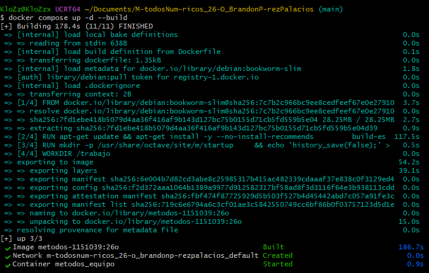
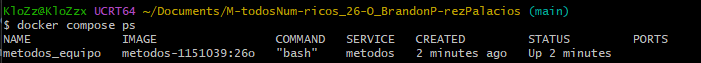
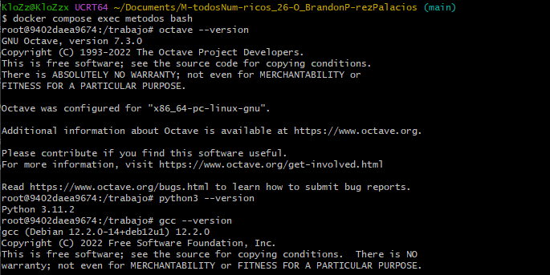
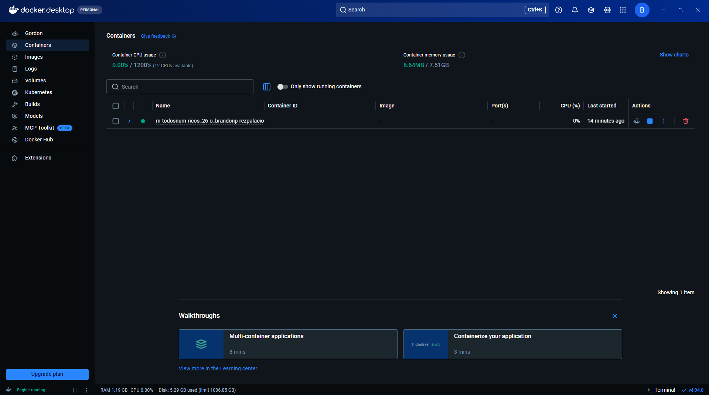
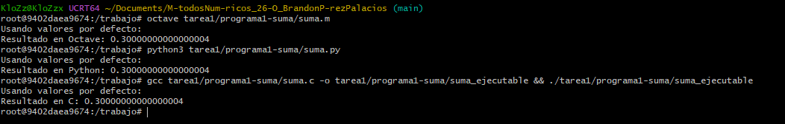

# Tarea 1.- Introducción a los Métodos Numéricos y Entorno de Trabajo

* **Unidad de Enseñanza-Aprendizaje:** Métodos Numéricos en Ingeniería (1151039)
* **Trimestre:** 26-O
* **Licenciatura:** Ingeniería Electrónica
* **Nombre completo:** Brandon Pérez Palacios
* **Matrícula:** 2252000616
* **Profesor:** M. en C. Gabriel Hurtado Avilés
* **Fecha:** 10 de octubre de 2026

**1. ¿Qué son los métodos numéricos? En qué se distinguen de una solución analítica, por qué su resultado es aproximado y qué papel tiene el error.**

Los métodos numéricos son técnicas matemáticas mediante las cuales es posible formular problemas para que puedan resolverse usando exclusivamente operaciones aritméticas simples como sumar, restar, multiplicar y dividir. Se distinguen de una solución analítica porque, mientras la solución analítica utiliza un despeje para entregar el valor verdadero y exacto mediante una fórmula cerrada, los métodos numéricos realizan iteraciones paso a paso para entregar un resultado aproximado. Debido a que la computadora no guarda los números con infinitas cifras y recorta procesos infinitos, el resultado siempre trae consigo un margen de error. El error juega un papel fundamental, ya que no es un defecto, sino una medida que nos indica qué tan lejos estamos del valor real y nos sirve como criterio para detener el cálculo cuando la exactitud es suficiente para los fines de ingeniería.

**2. ¿Cómo se aplican en la ingeniería? Diga cuál es su licenciatura —Ambiental, Civil, Eléctrica, Electrónica, Física, Industrial, Mecánica, Metalúrgica, Química o en Computación— y describa dos problemas concretos de esa área: qué se calcula y por qué no basta con una fórmula cerrada.**

En la licenciatura de Ingeniería Electrónica, el cálculo numérico es fundamental para modelar sistemas que no poseen una solución matemática directa. Dos problemas concretos son:
**•   Punto de operación de un diodo:** La relación entre voltaje y corriente de un diodo está dictada por una ecuación exponencial no lineal. Al plantear el circuito en un sistema, resulta imposible encontrar una fórmula cerrada para despejar las incógnitas analíticamente. Se emplean métodos numéricos de búsqueda de raíces para encontrar el voltaje operativo exacto evaluando aproximaciones sucesivas.

**•   Respuesta en el tiempo de un circuito RLC:** Analizar el comportamiento de un circuito con resistencias, inductores y capacitores ante variaciones eléctricas implica modelar ecuaciones diferenciales ordinarias (EDO). Cuando las señales de excitación o los componentes varían dinámicamente, se recurre a aproximar la respuesta de la señal discretizando el tiempo y calculando la tensión paso a paso con herramientas computacionales.

**3. ¿Qué herramientas se usan para trabajar con métodos numéricos? Un panorama por familias: lenguajes compilados (C, C++, Fortran), lenguajes interpretados, entornos matriciales (MATLAB, GNU Octave), Python científico (NumPy, SciPy, Matplotlib), álgebra simbólica y bibliotecas de base (BLAS, LAPACK). Diga cuál usa cada libro que consultó.**

Existen diversas familias de herramientas para trabajar con métodos numéricos. Por un lado, están los lenguajes compilados (como C, C++ y Fortran) que ofrecen un control total de la memoria y son muy rápidos. Por otro lado, tenemos los lenguajes interpretados y entornos matriciales (como MATLAB y su alternativa libre, GNU Octave) que son excelentes para trabajar con matrices de forma natural. También destaca el entorno de Python científico, utilizando bibliotecas de uso general como NumPy, SciPy y Matplotlib. Finalmente, se cuenta con herramientas de álgebra simbólica y bibliotecas de base súper optimizadas (como BLAS y LAPACK).

De los libros consultados del programa de estudios, el texto de Chapra y Canale (Métodos Numéricos para Ingenieros) utiliza principalmente MATLAB, mientras que el libro de Quarteroni y Saleri (Cálculo Científico con MATLAB y Octave) utiliza explícitamente ambos entornos.

**4. ¿Qué herramientas usamos en este curso? Se sugiere un párrafo por cada una: Docker; Docker frente a una máquina virtual; lo que vimos de Docker —el Dockerfile, el compose.yaml, y los comandos up -d, exec, stop, down, ps y logs, más la diferencia entre apagar un contenedor y borrarlo—; GNU Octave; Python; y C con gcc. Las versiones se obtienen del propio contenedor, no se inventan.**

**•   Docker:** Es una herramienta que empaqueta el entorno completo de trabajo para asegurar que todos usemos exactamente las mismas versiones. A diferencia de una máquina virtual, que carga un sistema operativo completo y es muy pesada, Docker usa "contenedores" que comparten el núcleo de la máquina anfitriona, por lo que arrancan en segundos y son ligeros. De Docker utilizamos el archivo Dockerfile (que es el "plano de fabricación" de la imagen) y el archivo compose.yaml (que es el manual para arrancar el entorno). Sus comandos principales son up -d para prender el contenedor, exec para entrar a trabajar a su terminal, ps para ver qué está corriendo y logs para diagnosticar por qué falló algo. Existe una diferencia crucial entre los comandos de apagado: stop simplemente apaga el contenedor, mientras que down (o rm) lo apaga y lo borra por completo; sin embargo, no perdemos nuestro trabajo porque usamos "volúmenes" (carpetas compartidas con nuestra computadora física).

**•   GNU Octave:** (Versión 7.3.0 instalada en el contenedor). Se utiliza en la etapa de "prototipado". Nos permite escribir el método numérico de manera rápida y sencilla para entender su funcionamiento y graficarlo, sin preocuparnos por que el código sea extremadamente rápido.

**•   Python:** (Versión 3.11.2 instalada en el contenedor). Utilizamos sus bibliotecas NumPy y SciPy para obtener resultados exactos de referencia y verificar que nuestros cálculos sean correctos; también usamos Matplotlib para generar las figuras que irán en los reportes.

**•   C con gcc:** (Versión gcc Debian 12.2.0-14 instalada en el contenedor). Se usa para la fase de "implementación". Al ser un lenguaje compilado, nos obliga a declarar los tipos de variables, reservar la memoria manualmente y decidir la tolerancia. Es aquí donde realmente se comprueba si se entendió la lógica del método numérico.

**## Ejercicio 3. Capturas del entorno corriendo**

**## Ejercicio 4. Programas**

\*\*¿Por qué 0.1 + 0.2 no da exactamente 0.3 y si los tres lenguajes coinciden?\*\*

Al sumar 0.1 + 0.2, el resultado no es exactamente 0.3 (sino 0.30000000000000004) debido a cómo funciona la aritmética de punto flotante y el estándar IEEE 754. La computadora almacena los números en formato binario. Números como 0.1 o 0.2 en sistema decimal se convierten en fracciones periódicas infinitas en el sistema binario (por ejemplo, 0.1 es 0.0001100110011...). Al no tener memoria infinita, la máquina "recorta" (trunca) la cantidad de bits, lo que genera un pequeñísimo error de redondeo; al sumar los dos errores, se vuelve visible en la cifra número 17. Los tres lenguajes (C, Python y Octave) coinciden en este error porque el estándar de precisión doble de los procesadores modernos es el mismo para todos.

\*\*Tabla de pruebas de la Calculadora:\*\*

| Caso de prueba | Operación | Entrada 1 | Entrada 2 | Resultado esperado |

| :--- | :--- | :--- | :--- | :--- |

| Suma normal | 1 (Suma) | 5 | 8 | Resultado: 13.0 |

| Multiplicación con decimales | 3 (Multiplicación) | 2.5 | 4 | Resultado: 10.0 |

| \*\*Error: División entre cero\*\* | 4 (División) | 10 | 0 | Error: No se puede dividir entre cero. El programa debe continuar. |

| \*\*Error: Entrada no numérica\*\* | 1 (Suma) | 5 | "letras" | Error: Entrada inválida. Por favor, escriba un número. |

**Cómo compilar y ejecutar los programas dentro del contenedor:**

**Para los programas de suma:**
* C: `gcc tarea1/programa1-suma/suma.c -o tarea1/programa1-suma/suma_ejecutable` y luego ejecutar con `./tarea1/programa1-suma/suma_ejecutable`
* Python: `python3 tarea1/programa1-suma/suma.py`
* Octave: `octave tarea1/programa1-suma/suma.m`

**Para la calculadora:**
* Python: `python3 tarea1/programa2-calculadora/calculadora.py`

**## Referencias**

Chapra, S. C., \& Canale, R. P. (2015). Métodos Numéricos para Ingenieros (7a ed.). McGraw-Hill.

Quarteroni, A., \& Saleri, F. (2009). Cálculo Científico con MATLAB y Octave. Springer.

Documentación oficial de las herramientas: docs.docker.com, docs.octave.org y git-scm.com/book/es/v2.

